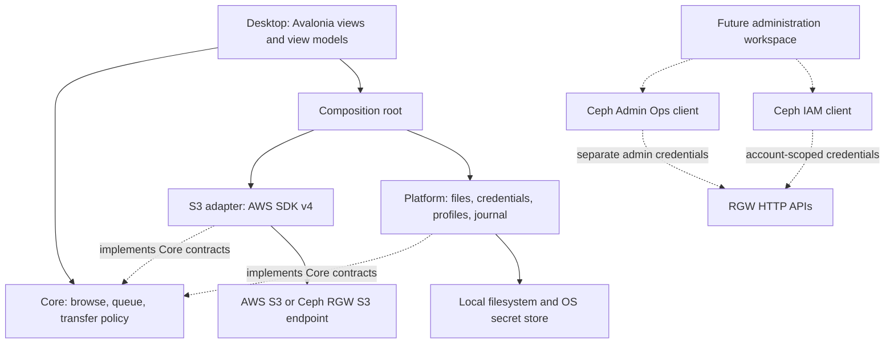
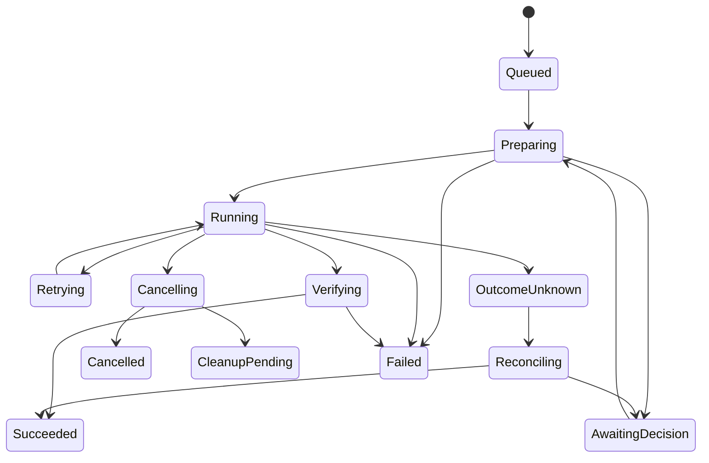

# BucketBus architecture

Status: DRAFT for review · 2026-10-21

The user selected **one desktop process with a small set of internal modules** and approved **ADR-006's MVP recovery contract** on 2026-10-21. The [engineering review and Phase 1A plan](PHASE1A_PLAN.md) recommends proceeding within these boundaries. Specific packages, journal mechanism and limits remain proposed pending implementation-plan approval and validation. Approved Session 1 created the four-project foundation and offline shell; [executed evidence](SESSION1_IMPLEMENTATION.md) is limited to its build and tests. Session 2 adds profiles, credential workflows and OS adapters; [Session 2 evidence](SESSION2_IMPLEMENTATION.md) distinguishes offline results from blocked native qualification. Session 3 implements provider-neutral read-only sessions, explicit SDK clients and bounded protocol normalization; [Session 3 evidence](SESSION3_IMPLEMENTATION.md) records offline validation and remaining provider qualification. Session 4 adds graphical read-only browsing with a five-page cache and independent navigation/metadata generations; see [Session 4 evidence](SESSION4_IMPLEMENTATION.md). Writes and durable recovery remain future implementation.

Confirmed planning inputs: typical files under 1 GB, LAN and WAN/VPN networks, Squid (19.x) as the primary Ceph validation family, and Fedora/.NET 10 SDK/Docker development. Exact provider builds/configurations require recorded qualification. Windows 11 VM evaluation remains a Phase 1A action. These inputs preserve the separate S3/Admin Ops/IAM/future Dashboard boundaries; administration remains outside MVP.

## Stack recommendation and alternatives

Retain C#, .NET 10 LTS, Avalonia, MVVM, and AWS SDK for .NET v4. .NET 10 is supported through 2028-11-14 under Microsoft's current policy; keep its servicing patches current. Self-contained releases include the runtime, so BucketBus must publish refreshed bundles for runtime fixes. [Support policy](https://dotnet.microsoft.com/en-us/platform/support/policy/dotnet-core), [publishing models](https://learn.microsoft.com/en-us/dotnet/core/deploying/)

Evaluate the current stable Avalonia 12.1 line, rather than assuming the older 11.x line. Pin the exact package set during the authorized implementation stage. Current documentation describes Windows/Linux support, a version-specific Wayland option, and Windows UI Automation/Linux AT-SPI2 accessibility. These are framework claims, not proof that BucketBus's panes, drag/drop, or virtualized rows will work correctly. Validate the actual chosen version on Windows and Fedora, including XWayland versus native Wayland. [Avalonia releases](https://github.com/AvaloniaUI/Avalonia/releases), [platform support](https://docs.avaloniaui.net/docs/supported-platforms), [accessibility](https://docs.avaloniaui.net/docs/app-development/accessibility)

| Approach | Benefits | Costs and recommendation |
| --- | --- | --- |
| C# + Avalonia + AWS SDK | Matches developer preference; shared desktop UI; SDK owns S3 request signing and serialization. | Managed runtime/native graphics increase distribution and memory footprint. Custom-rendered controls need platform UX and screen-reader testing. Preferred, contingent on measured gates. |
| WPF/WinUI Windows UI | Strong Windows integration and familiar .NET tooling. | A second Linux UI or a different portability layer would be needed. WPF itself runs only on Windows. Reject as the shared baseline. [WPF](https://learn.microsoft.com/en-us/dotnet/desktop/wpf/overview/) |
| C++ + Qt | Established Windows/Linux desktop option. | New language/build/SDK ownership and dependency-license review; no evidence that it would improve this project's delivery enough to justify switching. Reserve as fallback if Avalonia fails essential gates. [Qt platforms](https://doc.qt.io/qt-6/supported-platforms.html) |
| Tauri + Rust/web UI | Potentially compact application assets and familiar web UI development. | Adds Rust and web tooling plus OS webview dependencies; requires a separate comparison of accessibility and offline packaging. Less aligned with the selected desktop stack. [Tauri webviews](https://v2.tauri.app/reference/webview-versions/) |
| Existing transfer engine such as bundled rclone | Reuses broad transfer functionality. | Must own subprocess protocols, credential/config integration, version distribution, and semantics exposed through the UI. Worth reconsidering only if transfer-engine maintenance becomes the dominant cost. |

The selected structural alternative is a small modular application. A single project with folders was the minimal alternative; weaker compile-time boundaries were the downside. A runtime plugin host was the extensible alternative; extra loading/security/version contracts were not justified. Do not add a plugin SDK, message bus, microservices, repository-per-entity pattern, or generic cloud-management framework.

## Components and dependency direction



Four production projects created under the approved Session 1 scope:

- `BucketBus.Desktop`: views, view models, navigation, desktop integration, and composition root. View models call core workflows, not AWS clients.
- `BucketBus.Core`: application models, browsing contracts, transfer state machine, retry/conflict/integrity policies. No Avalonia or AWS types.
- `BucketBus.S3`: AWS SDK requests, exact key encoding, response/error normalization, provider dialect options. Depends on Core.
- `BucketBus.Platform`: filesystem safety, Windows/Linux secrets adapters, JSON profiles, SQLite job journal, and log sinks. Depends on Core.

Transfer management is a Core module, not a separately deployed process. Keep its provider-neutral decisions separate from S3 multipart execution. Later Ceph modules can be separate projects added when their features are built. Do not create empty future projects now. In-process separation prevents accidental credential reuse; it is **not** a security sandbox against malicious code in the same process.

## Small contracts, explicit semantics

Names describe intended responsibilities, not production interface definitions:

| Contract | Responsibility and boundary |
| --- | --- |
| ObjectStoreSession | List one page, read object metadata, stream a read, perform supported writes/deletes, and expose provider evidence. Session is bound to endpoint, credential source, region, and addressing mode. |
| MultipartOperations | Begin/upload part/complete/abort/list parts where needed. Optional supported operation group; do not force unrelated providers to fake it. |
| CapabilitySnapshot | Supported, unsupported, unknown, or configuration-dependent features with source, tested version, and observation time. Authorization is separate: allowed, denied, unknown for a specific operation/resource. |
| CredentialSource / SecretStore | Acquire an explicit credential lease and optional expiry; securely remember/retrieve credentials. No ambient provider chain or accidental admin fallback. |
| TransferCoordinator / TransferJournal | Own lifecycle, bounded scheduling, durable intent, restart review, and cleanup obligations. Provider calls stay in adapters. |
| LocalFileService | Enumerate, identify/open sources, plan safe destinations, create temporary output, and commit completed files. |
| CephAdminSession / CephIamSession | Later independent authorities and contracts, unavailable to ordinary transfer workflows. |

Use immutable lightweight records for connection ID, bucket, exact object key, optional version ID, opaque continuation token, object metadata, error category, and transfer intent. Do not turn object keys into filesystem paths or URI-normalize them. Keep tenant, account ID, RGW UID, and IAM principal identity distinct. No numeric enum limited to AWS storage-class names.

No universal S3 discovery API can be assumed. Prefer user-selected dialect plus versioned test evidence and passive observation. A 403 is not proof of unsupported functionality. A failed write is never a safe discovery probe. Endpoint/credential changes invalidate prior observations.

## Connections and network behavior

Profiles store display name, validated endpoint, signing region, addressing mode, optional initial bucket/prefix, credential-source type and local reference, and non-secret transfer settings. Client instances are scoped to one profile revision/credential lease; reuse HTTP connections within that scope. Editing a profile does not retarget running jobs.

Changing an endpoint disconnects the profile and requires explicit credential rebinding. Cancel obsolete browse requests and discard late responses from previous profile/navigation generations. View models consume injected Core workflows; only the Desktop composition root constructs S3 and Platform services. SDK v4 nullable responses must be validated and mapped before entering Core; unknown metadata must not become invented zero values.

For custom endpoints use explicit SDK credentials and region settings. The SDK's default resolution chain can otherwise search environment variables, profiles, containers, and instance metadata; that is unsuitable for silently selecting credentials for arbitrary user-supplied endpoints. [AWS credential resolution](https://docs.aws.amazon.com/sdk-for-net/v4/developer-guide/creds-assign.html)

Do not forward authentication across arbitrary redirects. Validated AWS region redirects require a controlled re-signing path; custom endpoint changes require a new approved target. Reject userinfo, query-string credentials, fragments, and unsupported schemes in endpoint URLs. Explain virtual-hosted DNS/certificate requirements, including dotted bucket names. No automatic addressing-mode switch after a failed mutation.

Proposed network policy: normal use requires HTTPS. Any explicitly authorized plaintext laboratory exception is confined to private development/test tooling and recorded locally; it must not become a shipped trust-bypass setting. Use OS trust stores first. Profile-scoped custom CA bundles are deferred until validation and lifecycle behavior are designed. LAN and WAN/VPN reachability changes must not silently retarget a profile or weaken TLS checks. Enterprise proxy use, proxy authentication and TLS interception remain unresolved requirements (Q09); do not infer them from VPN use. If required, review OS/.NET proxy settings, a no-proxy option and configuration-specific tests before claiming support.

Keep environment-specific endpoint, region, addressing mode, bucket/scope and credential-source configuration outside public documents and production defaults. The S3 adapter must support AWS SDK for .NET v4 custom endpoints and path-style addressing through explicit runtime settings. Bind the approved target to the explicitly selected credential source, without logging credentials or falling back to ambient identities. Developer tooling profile use does not expand MVP product authentication scope. Live tests remain separate from unit tests, require explicit opt-in and protect shared manual data; destructive operations and dedicated integration-test resource provisioning require approval. [TEST_STRATEGY](TEST_STRATEGY.md#live-integration-access-and-safety) defines the generic test contract. CLI-only checks do not establish SDK compatibility or TLS evidence.

## Browsing and object semantics

Use prefix plus delimiter for remote navigation and opaque continuation tokens for more pages. Default to 1,000 entries per page and retain at most five pages per active pane. Evicted pages can be fetched again; scrolling must not imply random access to unseen keys. Sorting by size/date and text filtering apply to loaded entries and are labeled accordingly. Prefix navigation can issue server-side prefix queries. Whole-bucket search and exact totals are deferred.

A folder is a presentation of prefixes, not a directory object. A zero-byte key ending in `/` may be a folder marker; expose it in details and avoid duplicate visual folders. Keys `a`, `a/`, and `a/b` may coexist. Preserve `%`, `+`, repeated slashes, case, Unicode, and control characters in underlying identity; escape unsafe display characters. Empty local directories may be represented by explicit zero-byte markers during folder upload, with that choice shown in the transfer summary. An empty prefix with no marker has nothing to download. [AWS object keys](https://docs.aws.amazon.com/AmazonS3/latest/userguide/object-keys.html)

Generic rename is deferred: for the targeted general-purpose buckets it must be designed as copy followed by conditional deletion, with independent failure and metadata handling. It is not a filesystem atomic move. Do not infer general support from newer provider-specific rename APIs.

AWS S3 documents strong read-after-write consistency for object PUT/DELETE and listing; do not describe all S3 as eventually consistent. Transport failure can still leave a write outcome uncertain. Ceph multisite replication and other providers require separate guarantees and observations. [AWS consistency](https://docs.aws.amazon.com/AmazonS3/latest/userguide/Welcome.html), [Ceph multisite](https://docs.ceph.com/en/tentacle/radosgw/multisite/)

## Transfer lifecycle and persistence



The journal additionally tracks interrupted jobs after process death and independent cleanup obligations. The diagram is the main path, not permission to omit cancellation/error exits from other active states.

1. Capture immutable intent: endpoint/profile revision, exact source and destination, conflict policy, object identity observations, and credential reference, never credentials.
2. Enumerate selected trees incrementally into a disk-backed manifest. Show “discovering” until counts are known; do not accumulate millions of jobs in UI memory. A manifest is not a snapshot of a changing remote bucket. Persist enumeration checkpoints; after crash, MVP restarts discovery and deduplicates exact item identities, requiring review of changes before execution.
3. Resolve name/conflict decisions, validate source readability and destination containment, and acquire a credential lease. Reserve a job in the journal before network side effects.
4. Stream bytes through bounded buffers. Proposed initial limits: four HTTP transfer requests globally, at most two multipart requests per object within that global bound, 1 MiB copy buffers, and 16 MiB initial parts. Multipart starts at 64 MiB; increase part size as needed for provider part-count limits. These are tuning proposals, not S3 protocol constants. Bound memory even if a provider requires larger parts.
5. Commit result only after the SDK operation and verification have completed. Publish throttled progress snapshots to the UI, initially at most 10 updates/second per visible transfer.

Use versioned JSON for profiles/settings with atomic replacement. **SQLite remains the preferred journal implementation, conditionally recommended by engineering review and awaiting selection approval/validation**, for transactional state, manifests, and cleanup records without an ORM. ADR-006 approves persistence requirements, not this mechanism. A single in-process writer owns schema migrations and transactions; a per-user instance lock prevents competing writers. Journal corruption disables automatic recovery, preserves evidence, and requires explicit recovery actions. The database is not a secrets vault; paths, keys, upload IDs, and filenames are still sensitive per-user data.

The review recommends local-disk WAL with FULL synchronization, short transactions, a bounded worker away from the UI, durable intent before remote effects, transactional versioned migrations and consistent backups. No network operation holds a database transaction open. Disk-full/commit failure blocks new mutations; unknown schemas or corruption must never trigger silent database recreation. These mechanisms require crash/migration/native-package tests at 1C; see the [review's persistence contract](PHASE1A_PLAN.md#transfer-and-sqlite-review-requirements-for-1b1c). SQLite is not needed for read-only 1A.

SQLite adds one persistence dependency plus native packaging. Alternatives: in-memory state loses recovery; atomic JSON snapshots are suitable for profiles but awkward for large manifests and concurrent state changes. Revisit only if measured complexity or packaging outweighs the recovery benefit.

### Retry, cancellation, and crash behavior

**Approved scope (ADR-006):** durable queued/interrupted jobs, accurate uncertain-outcome records, bounded transient retries, safe in-session multipart-part retries, known cleanup obligations, reconciliation and explicit user confirmation before whole-object restart after application restart. Cross-restart partial-byte resume is deferred to Phase 2. Typical files under 1 GB support this scope choice but do not prove retransmission will be cheap on a WAN/VPN.

Proposed mechanism: let the SDK own bounded per-request transient retries only after a per-operation replay-safety review, with application-level scheduling sharing a single attempt/time budget. Proposed ceiling: five total attempts per request, exponential backoff with jitter capped at 30 s, and a visible exhausted state. Avoid multiplying SDK and job retries. Respect server retry guidance. Do not retry auth, permissions, TLS, name validation, or checksum failures indefinitely. Expired credentials pause only affected work. Automatic SDK retry configuration must not bypass the application's uncertain-write rule; inspect and test the selected SDK's actual behavior before accepting it.

For 1A read-only listing/metadata, the review proposes a narrower three-total-attempt/30-second total budget. The transfer ceiling above remains a separate unvalidated proposal; it does not authorize generic retries of uncertain writes. Validate actual SDK attempts, cancellation and async deadlines before adopting either policy.

Engineering review must distinguish connection establishment, response-header wait, body inactivity, cancellation and overall operation deadlines. Set finite budgets without timing out a slowly progressing long transfer solely because it exceeds a short LAN-oriented duration. Timeout values and progress rules remain proposed work, not approved constants. A timeout or VPN reconnect does not prove the server rejected a mutation; recheck reachability and TLS identity without switching endpoint/credentials automatically.

Idempotency means repeating an operation without unintended additional effects; it must be assessed for each operation and provider. Before sending a mutation, durably record intent and enough identity/state to treat an interrupted in-flight attempt as uncertain after a crash. A multipart-part retry must retain the same upload identity, part number and stable bytes; do not blindly replay initiation, completion or ordinary writes under a generic transient-error rule. Define separate handling for confirmed rejection, proven safe retry and an outcome that needs reconciliation. This is an engineering obligation, not a claim that exactly-once transfer can be guaranteed.

Within a live multipart job, retry failed parts only where safe. Persist upload ID immediately after initiation and before part scheduling. There is an unavoidable crash window between server initiation and recording the ID: a lifecycle rule configured by an administrator is the recommended backstop. BucketBus does not silently install such a rule.

Cancel stops scheduling, cancels requests, waits for in-flight operations to settle, and attempts abort using the same authority. A failed abort becomes CleanupPending. Never abort other applications' uploads. The SDK multipart ETag is not generally an MD5 checksum; unfinished uploads consume storage until completed/aborted. [AWS multipart](https://docs.aws.amazon.com/AmazonS3/latest/userguide/mpuoverview.html)

After restart, show interrupted jobs, uncertain outcomes and cleanup obligations before doing remote work. Reconcile a possibly completed write before deciding whether cleanup or a restart is appropriate. Require explicit user confirmation to restart interrupted jobs, perform required cleanup of known incomplete uploads, revalidate source and destination/conflict policy, and start the object from the beginning. Confirmation does not clear unresolved uncertainty; preserve it and require explicit case resolution rather than silently replaying. Downloads restart into a new temporary file after safely removing only the application's recorded partial file. Partial-byte resume across process restart is deferred to Phase 2. Local source identity/size/time checks detect common changes but cannot prove a live file was immutable; tell users to transfer stable files or snapshots, and fail when a change is detected.

Completion can fail after an HTTP 200 header; rely on the SDK's full response handling. A lost response after a write is OutcomeUnknown, not automatically Failed. Read-back may use version ID, trusted checksums, size and operation metadata if available. Size alone cannot prove authorship; denied or ambiguous read-back requires user review. Do not automatically repeat a potentially successful write to a versioned bucket. [CompleteMultipartUpload](https://docs.aws.amazon.com/AmazonS3/latest/API/API_CompleteMultipartUpload.html)

Review ADR-006 against observed large objects, frequent WAN interruptions, unacceptable retransmission bytes/time/cost and repeated user complaints during alpha feedback and before public v1.0. Maximum object size and interruption frequency remain unmeasured; collect evidence without introducing default telemetry. Reopening this decision must preserve integrity, overwrite protection and the no-silent-replay rule.

### Integrity and overwrite policy

Keep modern SDK checksum protection enabled by default. Providers may differ in checksum algorithms, trailers and request encoding; record a tested compatibility profile for an endpoint. Do not globally disable validation to make one gateway work. When full-object verification is unavailable, disclose the actual verification level; a locally computed hash alone does not prove equality with remote bytes. [AWS checksum behavior](https://docs.aws.amazon.com/sdkref/latest/guide/feature-dataintegrity.html)

For AWS protected creation use `If-None-Match: *`; for approved replacement use `If-Match` when supported, with the ETag from the inspected object. These can apply to PUT and multipart completion; exact provider support must be validated. A prior HEAD check alone leaves a window for another writer to change the destination. [AWS conditional writes](https://docs.aws.amazon.com/AmazonS3/latest/userguide/conditional-writes.html)

When safe preconditions are unsupported or unverified, pause protected uploads: offer Skip, another key (collision risk still disclosed if no atomic creation is available), or **explicitly confirmed unconditional replace** through an advanced warning. Never label the latter “safe no-overwrite.” If the user requires guaranteed no-overwrite, refuse the upload on that endpoint. Re-ask on 409/412; do not convert them to unconditional retries. A 403 HEAD does not mean absence.

Downloads use exclusive temporary files on the destination filesystem, verify content, then perform a platform-appropriate atomic commit where supported. No-replace and replace are different operations. If the filesystem cannot provide the required commit semantics, fail with an explanation rather than erase the previous file first. [Security model](SECURITY_MODEL.md) defines path containment and collision rules.

## Proposed repository layout

```text
docs/                   public planning and ADR-style decisions
  internal/             ignored local environment configuration and evidence
src/
  BucketBus.Desktop/
  BucketBus.Core/
  BucketBus.S3/
  BucketBus.Platform/
tests/
  BucketBus.Core.Tests/
  BucketBus.S3.Tests/
  BucketBus.S3.IntegrationTests/
  BucketBus.Platform.Tests/
  BucketBus.Desktop.Tests/
test-assets/            small synthetic fixtures; no secrets or large binaries
eng/                    reproducible build/release scripts when authorized
.github/workflows/      CI when authorized
```

Do not create these directories as scaffolding during planning. Build Windows artifacts on Windows CI initially, Linux artifacts on Linux CI; Linux development is not a substitute for Windows runtime validation. Publish a self-contained folder in a ZIP first. Single-file packaging can extract native components and is not required by “portable.” Native AOT/trimming are deferred until measured savings justify compatibility work. [Single-file deployment](https://learn.microsoft.com/en-us/dotnet/core/deploying/single-file/)

## AGENTS.md recommendation

Create a concise root AGENTS.md only when the user approves the planning baseline. It should contain: current phase and explicit implementation authorization; links to the nine documents; build/test commands only once real; core dependency rules; secret/log/path-safety requirements; evidence standards for provider support; migration/release approval boundaries; and a rule to record scope changes in DECISIONS.md. It should not duplicate the whole plan or invent runnable commands.

Add nested guidance only where necessary: `src/BucketBus.S3/AGENTS.md` for exact-key/checksum/retry rules, `src/BucketBus.Platform/AGENTS.md` for OS security, and `tests/AGENTS.md` for fixture versus real-provider evidence and disposable-resource cleanup. No blanket permission to contact production, deploy, or generate credentials.
