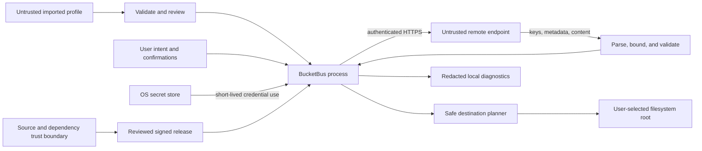

# BucketBus security model

Status: DRAFT threat assessment and proposed controls · 2026-10-21

The Session 1 shell has focused offline checks for safe diagnostics and project boundaries; full security qualification has not been performed. See [Session 1 evidence](SESSION1_IMPLEMENTATION.md). This model establishes obligations for design review, development, and release qualification; it is not a certification.

## Assets, adversaries, and trust boundaries

Protect access/secret keys, session tokens, future administrative keys, local files, remote object contents, connection identity, downloaded filenames, policy documents, and release artifacts. Endpoints, buckets, object names, local paths, and queue history may reveal sensitive business information even without credentials.

Threats include a malicious or compromised object-storage endpoint, crafted object names/metadata, a hostile imported profile, network interception, compromised dependencies/build pipelines, accidental operator action, and unrelated software running as the same OS user. The OS, runtime, and enabled in-process modules are in the trusted computing base. The application cannot protect secrets from a fully compromised user session, administrator, debugger, or memory dump. OS secret storage is at-rest protection, not an application sandbox.

## Early threat register

| Threat | Required controls | Residual risk / evidence needed |
| --- | --- | --- |
| Secret leakage in config/export/logs | OS vault, secret-free export allowlist, explicit credential leases, redaction before sinks | Same-user malware and dumps remain capable of theft. Test every error path and admin response. |
| Profile redirects credentials to an attacker | Imports disconnected; no imported vault references; show target; rebind credentials explicitly; no cross-host auth forwarding | Users can intentionally trust a malicious endpoint. Do not disguise endpoint identity. |
| MITM or wrong certificate | HTTPS, normal chain/hostname validation, enterprise CA via approved OS trust | Corporate trust roots expand trust. Validate supported proxy/interception configurations. |
| Arbitrary object names overwrite local files | Strict containment, component validation, collision detection, safe handles/no-follow behavior | Filesystem and reparse semantics vary; fail closed when safety cannot be established. |
| Remote overwrite or misleading success | Conditional operations where tested, explicit fallback choice, durable outcome state and reconciliation | No universal compare-and-swap across providers; ambiguous outcomes need operator review. |
| Multipart cancellation leaves billed data | Per-job upload journal, bounded abort retries, cleanup queue | Initiation-before-journal crash gap and revoked cleanup permissions require an operator/lifecycle backstop. |
| Large/malformed listing exhausts memory | Page/buffer bounds, streaming, response size limits, parser hardening, cancellation | Provider payloads can still stress libraries; fault-inject oversized and malformed responses. |
| Admin credential accidentally used for transfer | Separate profile types, vault namespaces, session factories and explicit workspace entry | Same-process modules are trusted; UI separation is not memory isolation. |
| Policy change locks out operators or grants public access | Read/diff/validate/review/apply/read-back, separate confirmation, preserve original | A syntactically valid policy may still be unsafe; no reliable effective-permissions simulation promised. |
| Supply-chain compromise | Pinned dependencies/actions, lockfiles, SBOM, license review, least-privilege CI, provenance and signed artifacts | A signature proves origin, not absence of malicious code. Review and patch response remain necessary. |

## Credentials and portable operation

**Windows strategy (implemented in Session 2; native qualification pending):** Windows Credential Manager generic credentials for remembered static secrets, scoped to the current user with local-machine persistence. Use an opaque application/profile/revision target name, not arbitrary imported references. Avoid enterprise roaming persistence. Respect native blob size limits; never truncate a token to fit. Temporary session credentials are memory-only in MVP. [Windows credential structure](https://learn.microsoft.com/en-us/windows/win32/api/wincred/ns-wincred-credentialw), [CredWrite](https://learn.microsoft.com/en-us/windows/win32/api/wincred/nf-wincred-credwritew)

**Linux strategy (implemented in Session 2; native qualification pending):** Tmds.DBus 0.95.1, selected after dependency review, talking to an available user-session secret service. Handle locked collections, cancelled unlock prompts, and missing services. If secure storage is unavailable, offer session-only credentials and explain that “Remember” is unavailable. Never fall back to plaintext files or an application-embedded encryption key. Secret Service implementations define their own locking/protection behavior; validate supported desktop environments. [Secret Service specification](https://specifications.freedesktop.org/secret-service/latest-single/)

Connection export is a schema allowlist of non-secret fields. Strip credentials, access-key IDs, session tokens, vault references, proxy credentials, and administrative bindings. Endpoint and bucket names are still potentially sensitive; show the exported contents. Import rejects unsafe URL forms and oversized/unrecognized fields, assigns fresh local identities, and requires explicit credential binding. Do not copy local secrets just because a profile name matches.

Editing an existing endpoint also disconnects its profile and requires explicit credential rebinding before reconnecting. Release composition must not accept a development/test flag that enables plaintext transport or disables certificate validation. Keep any authorized private HTTP harness outside the published Desktop dependency graph; test this exclusion as well as normal TLS rejection paths. The [Phase 1A plan](PHASE1A_PLAN.md) defines binding and native-store acceptance tasks. [Session 2 evidence](SESSION2_IMPLEMENTATION.md) records target fingerprints, local Unix-bus transport, native buffer handling, and the non-transactional vault/JSON cleanup limitation. These implemented paths do not constitute native OS qualification.

Never render saved secret values except through an explicit reveal action. Clipboard copying is deliberate and warns about clipboard history; do not promise that clearing the current clipboard erases history. Minimize retention and clear owned byte buffers where feasible, but do not promise perfect zeroization of managed strings. No secrets in process arguments, URLs, environment dumps, SQLite, crash reports, or debug trace payloads.

Future file-transfer, Admin Ops, IAM, and Dashboard identities have distinct credential references and explicit authority labels. Do not infer that a transfer key is safe to use for admin tasks. Account root identities are never a recommended ordinary-transfer default.

## Least privilege and permission evidence

A direct bucket/prefix connection does not call account-wide ListBuckets. Reading objects, listing keys, writing, deleting, reading versioning, and aborting multipart uploads are separate permissions. Metadata or status reads may be denied even when a transfer is allowed. UI permissions are observations for an operation/resource at a point in time; the server remains authoritative.

A user-selected “read-only” mode suppresses application writes, but it is not an authorization boundary. Recommend actual read-only credentials when needed. An upload user may lack abort or read-back privileges; expose this limitation and retained cleanup obligations. Never silently escalate or borrow credentials from an admin session.

## TLS, endpoints, and logs

Use OS trust and standard hostname validation. Reject expired/untrusted/wrong-name certificates with actionable messages, not a “continue anyway” checkbox. Enterprise CA setup is external operator work in MVP; BucketBus does not modify machine trust stores. A future per-profile CA feature must validate the full chain and hostname, restrict scope to that endpoint, and define revocation/rotation behavior.

**Laboratory exceptions:** any explicitly approved plaintext endpoint must be restricted to private development/test tooling, with its concrete configuration and authorization recorded locally outside public documentation. Production requires HTTPS with normal certificate validation and no shipped bypass. Bind an explicitly approved target, region and addressing mode to the selected test credential source. Never hardcode, print, commit or expose credential values; do not fall back to ambient credentials, forward signed requests through unrelated proxies, or follow authenticated redirects to another host. Developer profile use does not expand product authentication scope. Enterprise proxies and TLS interception remain unresolved requirements rather than assumptions about VPN use.

Shared manual-testing data must never be deleted or overwritten by integration tests. Begin target assessment with authorized non-destructive reads. Live integration tests remain separate from unit tests and require explicit opt-in. Before destructive operations or provisioning dedicated integration-test resources, obtain approval for a concrete isolated test scope. Future write/overwrite/permission tests must track only approved test-owned objects/upload IDs for cleanup. See [live integration safety](TEST_STRATEGY.md#live-integration-access-and-safety). CLI reads alone do not establish security qualification or least privilege.

Log structured categories and safe identifiers. Redact Authorization, cookies, security tokens, presigned query strings, secret fields in nested JSON/XML, and proxy auth before serialization. Raw HTTP body/header logging is disabled. Admin read responses may contain credentials, so “read-only” traffic must also be treated as secret-bearing. [Ceph Admin Ops user information](https://docs.ceph.com/en/tentacle/radosgw/adminops/#get-user-info)

Escape newlines/control characters in provider text and object names to prevent forged log entries or misleading UI. Bound error payload size. Diagnostic export is opt-in, previewable, and redacted; no automatic upload. Proposed retention: rotating logs capped at 20 MiB total; completed-job history 30 days, user-clearable. Keep unresolved cleanup obligations until explicitly resolved/discarded. Per-user permissions protect settings/journal/logs from other nonprivileged accounts where the OS supports it.

## Public documentation and local evidence

Public documents may describe credential types, security controls, test procedures and non-sensitive product decisions. Keep real endpoints, bucket/account/principal identifiers, credential-source names, network topology, hosting details and local run records under ignored `docs/internal/`. Secret values must remain in approved credential stores, never in documentation, including internal notes. Publish compatibility evidence only after removing sensitive infrastructure and response data and reviewing the remaining build/configuration details for disclosure. Public documents must not depend on links to private files.

## Safe local paths and arbitrary object names

The remote key is an opaque identifier. Local path generation is a separate validated operation. Never pass the key directly to path-combination functions and assume it is safe.

1. Validate each destination component before opening anything. Reject absolute/UNC/device paths, drive prefixes, NUL/control characters, `.`/`..` components, and Windows alternate data streams. Treat backslashes as dangerous on Windows even when they are literal S3 characters.
2. Detect reserved Windows device names, trailing dots/spaces, invalid characters, path-length failures, case-insensitive collisions, and normalization collisions. Also detect file/directory conflicts such as keys `a` and `a/b`.
3. Preserve the exact remote key. Present Skip or an explicit local-name mapping; never silently sanitize two keys into the same filename. Persist batch mappings and revalidate uniqueness. A bulk reversible encoding scheme can be a later feature.
4. Verify final destinations stay beneath the user-selected root. Prefix-string comparison alone is insufficient. Use platform-aware path boundaries and handle-based/no-follow checks to prevent symlink/junction/reparse escapes, including changes between validation and write. Refuse unsafe or unsupported targets.
5. Create a uniquely named temporary file exclusively in the destination filesystem with restrictive permissions. A predictable `.part` name is insufficient. Verify it is the recorded application-owned file before cleanup. Commit using tested no-replace or approved replace semantics; do not delete the old destination before committing the new one.

For uploads, do not follow symlinks/reparse points recursively by default. Special files, device nodes, pipes, and sockets are not ordinary upload sources. Avoid opening remote content automatically, executing scripts, generating thumbnails by external tools, or preserving executable permission bits implicitly. Respect safe OS attachment/security metadata where supported; define and test Windows downloaded-file handling before release.

## Destructive and administrative changes

MVP deletes only explicitly selected object rows and records each outcome. A batch can partly succeed. An uncertain delete must be reconciled or reviewed before repeating; another writer may have created a new object with the same key. Never claim a batch is atomic or an object is recoverable solely because versioning might be enabled.

Future policy editing: fetch the original, preserve exact content, show scope/authority and a semantic/text diff, parse JSON and validate known provider-specific grammar, flag wildcards/public principals/denies, and require a review action. Syntax validation is not an effective-permissions calculation. Re-read immediately before applying and warn on changes; without a server precondition this is best-effort change detection, not concurrency protection. Read back after success. A saved original is a recovery aid, not guaranteed rollback when permissions have changed.

Future key rotation: create an additional credential, show/store it through a secure explicit workflow, test a minimal authorized operation, let the operator migrate consumers, then separately confirm revocation of the old key. Never revoke first, silently replace a live key, or claim all external consumers migrated. Respect each provider's key-count limits and account model. Do not put generated secrets in audit records.

Local administrative audit records should capture actor label, endpoint identity, target, operation, redacted diff, confirmation and outcome. They are not tamper-proof evidence. Central audit integration requires a separate design and opt-in authority.

## Dependencies, builds, and release security

Proposed controls: minimal reviewed package set, lockfiles, pinned SDK and CI action revisions, dependency/license inventory, vulnerability scanning with documented exceptions, protected release jobs, short-lived CI identity where supported, and no signing secrets exposed to pull requests. Self-contained releases require runtime servicing releases from BucketBus, not just an SDK update on a developer machine.

Public releases should include an SBOM, source revision, SHA-256 checksums, build provenance, release notes, and signed Windows binaries with timestamping. Signing identity/cost and trusted publishing route remain open. Test the extracted signed ZIP on a standard-user clean VM. Signing does not guarantee SmartScreen reputation or enterprise allowlisting.

Pursue deterministic unsigned build outputs in pinned environments and compare independent builds before claiming reproducibility. Signing timestamps and ZIP metadata can differ; publish what was reproduced and how signatures relate to the compared payload. An update mechanism is deferred; manual downloads remain verified through release provenance/checksums/signatures. Never replace a running binary from an unverified endpoint.

## Session 3 implemented read-only boundary

[Session 3 evidence](SESSION3_IMPLEMENTATION.md) covers explicit profile-revision credentials, session invalidation, final outbound HTTPS/authority/method checks, rejection of all redirects, bounded GET/HEAD attempts and normal TLS validation. SDK raw logging and client-side monitoring are disabled; failures expose fixed categories rather than provider bodies or exceptions. A leading-slash HEAD path correction runs before SDK signing, with outgoing path and signature fixtures. This is read-only policy; future writes require their own retry/ambiguity review. Live provider, enterprise trust and native platform qualification remain pending. Session 2 crash-orphan vault limitations remain unresolved.

## Session 4 browser boundary

The browser consumes Core contracts, acquires credentials only on explicit Connect and cancels superseded acquisition/navigation/metadata operations. Navigation and selection generations reject late completions. Provider names/metadata are bound as plain text; unsafe display characters are escaped separately from unchanged keys. Error messages use fixed categories and browser operations add no raw diagnostic logging. The five-page cache and virtualized list limit retained/rendered data. [Session 4 evidence](SESSION4_IMPLEMENTATION.md) records offline coverage; native platform, enterprise trust and live provider qualification remain pending.

## Phase 1B.2 interim transfer safety

Single-file transfers are pre-alpha and do not claim ADR-006 crash durability. Uploads use a pinned profile revision, explicit credentials, HTTPS, conditional creation and no SDK retries. Operation identity plus full content read-back can reconcile a lost response; incomplete evidence remains Outcome Unknown. Native file adapters reject links/reparse ancestors and unsafe local leaf names, stage owned temporary output, and never replace an existing final name. Linux uses no-follow directory handles and a hard link from the actual open inode; Windows denies ancestor write/delete sharing and uses handle-based no-replace rename. No copy/delete fallback exists. These controls do not sandbox another malicious process running as the same OS user. Windows execution and attachment-zone metadata handling remain release qualification gaps. After a crash, manual inspection/temporary cleanup may be necessary; no automatic restart or cleanup of unknown remote objects occurs.
